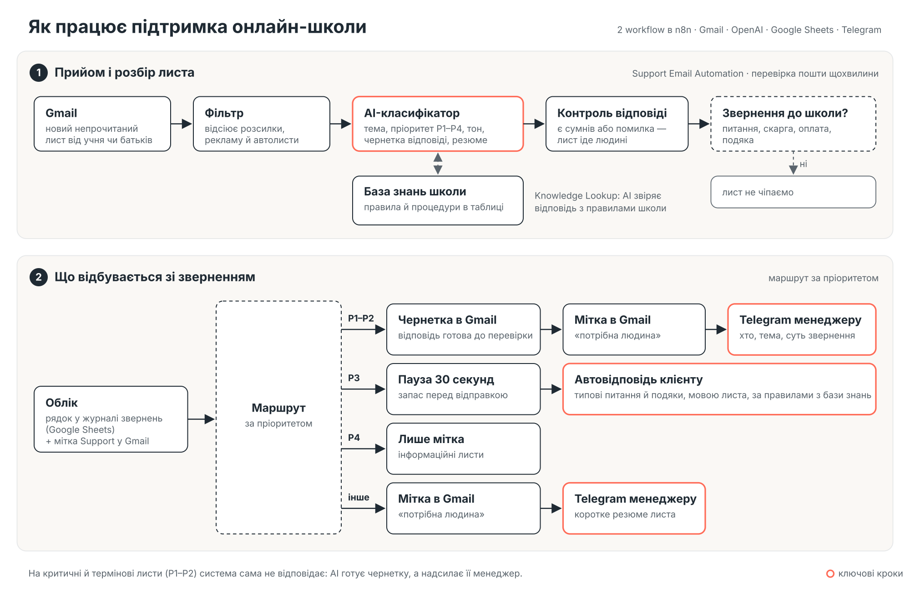
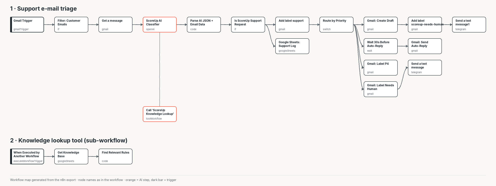

# AI Support Assistant for Online Schools

**Routine student questions get an answer from the school's own rules; payments, complaints and anything unclear go to a person with a ready draft.**

Demo project by Procesto. The scenario is modelled on a fictional online exam-preparation school and tested on test e-mails.

## The problem

> "Half of the e-mails are about a lesson recording or homework, and we write the same answer every time. And an e-mail saying 'you charged me, but I have no access' gets noticed a day later."

- All e-mails land in one inbox, together with newsletters and ads.
- Routine questions are answered by hand, slightly differently each time.
- Urgent and sensitive e-mails, such as payments and complaints, wait in the common queue.
- Students write in Ukrainian, Polish and English.

## What the system does

1. **Filtering.** Newsletters and automated e-mails are filtered out before AI.
2. **Classification.** AI decides whether the e-mail is really about the school. It sets the topic (lesson access, recording, homework, payment, complaint), the priority and the tone.
3. **School rules first.** Before replying, AI checks the school's knowledge base: what to check, what to do, when to hand over to a person, how to answer. If there is no rule, it does not invent one and hands the e-mail to a person.
4. **Simple cases**, such as where to find materials or a thank-you: a reply in the student's language goes out automatically after a short delay.
5. **Urgent and sensitive cases**, such as payment, suspected fraud or a complaint: AI prepares a draft in the mailbox and labels it. The manager gets a short summary in Telegram. Only a person sends the reply.
6. **Log.** Every e-mail goes to a log: topic, priority, tone, action and suggested reply.

AI never invents links, dates, payment statuses or school rules, and never asks for passwords or card details. It ignores instructions inside e-mails. If its output is invalid, the e-mail goes to a person.

## Before / after

|  | Before | After |
| --- | --- | --- |
| Routine questions | by hand, different every time | auto-reply by the school's rules |
| Urgent e-mails | in the common queue | manager alert + ready draft |
| Reply language | whatever happens | the student's language |
| Newsletters and spam | take attention | filtered automatically |
| Control | none | log of all requests |

The knowledge base is a plain spreadsheet, so changing an answer rule does not need a developer.

## Under the hood

- Gmail Trigger (every minute) → bulk-mail filter → AI classifier with a knowledge-lookup tool (sub-workflow over Google Sheets) → JSON validation → log.
- Routing:
  - P1/P2 → draft + label + Telegram;
  - safe P3 → 30 s delay → auto-reply;
  - P4 → label;
  - everything else → "needs human" queue.

**Stack:** n8n · OpenAI GPT-4o-mini · Gmail · Google Sheets · Telegram Bot API

## Workflow map

Generated from the n8n export: every node and connection as built.

## Get the full workflow

The workflow files and prompts are not published. To see the system running on a call, or to get it set up with your school's rules and mailbox:

→ **[Fill in a short brief](https://tally.so/r/J1lLxK?utm_source=github&utm_medium=repo&utm_campaign=portfolio&utm_content=school-support-ai-kb)** · [Full case study](https://super-kettle-5ea.notion.site/41d396519ffa81148634fe15e559a11a) · [procesto.eu](https://procesto.eu)

---

© 2026 Procesto. All rights reserved.
